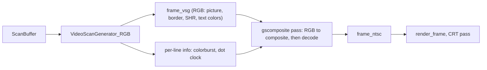

# Packed Bitstream and GPU NTSC Decoder (design)

Status: phase 1 implemented (all platforms). Phase 2 implemented for macOS /
Metal only; Windows (DXIL) and Linux (SPIR-V) builds of the shader are not made
yet, so those hosts use the phase 1 CPU decoders. See "Phase 2 as built" for
where the implementation differs from the design below. Phase 3 (IIgs composite
from the RGB stream through a modeled encoder chip) is implemented for macOS /
Metal; see "Phase 3 as built". Phase 4 lists follow-ups for cycle-accurate IIgs
video switches.

## Goal

Speed up the legacy Apple II video path (composite and monochrome monitor
engines) in two phases:

- **Phase 1: packed bitstream (CPU).** `VideoScanGenerator_Comp` emits packed
  bits instead of one byte per dot. `NTSC560` and `Monochrome560` read the
  packed bits. This helps every platform, including the ones that cannot use
  phase 2 (web build, hosts without Metal / D3D12 / Vulkan, software rendering).
- **Phase 2: GPU decoder.** A fragment shader replaces `NTSC560::render` and
  `Monochrome560::render` when the SDL GPU renderer is active. The phase 1
  buffer is uploaded as-is (~15 KB) instead of the full 910×263 RGBA texture
  (957 KB).

Phase 1 stands on its own and is a prerequisite for phase 2. The packed layout
and the display geometry below are shared by both.

Out of scope: the RGB monitor engine (`VideoScanGenerator_RGB`, including the
IIgs RGB path) and IIgs super hi-res. They do not produce the 560-dot bitstream;
they write colors straight into `frame_vsg`.

## Current pipeline (composite and monochrome engines)

1. `VideoScanner*::video_cycle()` pushes one `Scan_t` per video cycle into `ScanBuffer`.
2. `VideoScanGenerator_Comp::generate_frame()` turns the scans into `Frame560`.
   That is a 560×192 bitstream, one byte (0/1) per dot, plus a per-line
   `color_mode_t` (colorburst, phase_offset). Mixed mode is already resolved here.
3. `NTSC560::render()` (or `Monochrome560::render()`) converts each line to RGBA
   and writes it into `frame_vsg`, a 910×263 streaming `SDL_Texture`, at row
   `y+35`, starting at column `168 - 7*shift_enabled`. `NTSC560` rebuilds a
   15-bit window from the bytes with a shift register and looks it up in `g_hgr_LUT`.
4. `update_display_apple2_cycle()` locks and unlocks `frame_vsg` around step 2-3.
   That uploads the whole texture. It then calls `render_frame()`, which draws it
   into `scene_target` (when the CRT shader is on) or the swapchain.
5. `present_scene()` runs the CRT post-process shader over `scene_target`.

Measured on Apple Silicon: step 3 takes ~50 µs/frame after the local-pointer
rewrite (~135 µs before). Step 2 has the same per-dot pattern (each of the 14
dots per screen byte is a separate store that reloads the frame's row pointer
and position). The texture lock/upload in step 4 has not been measured. On a
Raspberry Pi 4 class CPU, all of these are expected to be several times larger.

The byte-per-dot `Frame560` is 107 KB per frame. That is cache-resident, so
memory bandwidth is not the cost. The cost is instruction count: 14 stores per
screen byte in step 2, then one load and a shift-register step per dot in step 3.

## Display geometry (shared)

Each line is 560 dots, but the visible display area is not always 560 dots
wide. It depends on the platform:

| Platform | Display area | Why |
|---|---|---|
| IIe, IIe PAL | **567 dots**, columns 161..727 | 80-column modes start half a 1 MHz cycle (7 dots) earlier than 40-column modes |
| II, II Plus | 560 dots, columns 168..727 | no 80-column modes, so every line is a 40-column line |
| IIgs | 560 dots, columns 168..727 | legacy modes are generated differently; no half-cycle offset (`shift_enabled` is false) |

On the IIe, the 80-column modes (TEXT80, DLORES, DHIRES; `phase_offset == 1`)
occupy columns 161..720. The 40-column modes (TEXT40, LORES, LORES_7M, HIRES,
HIRES_NOSHIFT; `phase_offset == 0`) occupy 168..727. **The output region must be
the full 567 columns.** Clipping it to 560 loses real output: either the first 7
dots of every 80-column line or the last 7 dots of every 40-column line. Mixed
screens (e.g. 80-column text under graphics) show both offsets in one frame.

Both phases work in **display coordinates**, with one per-platform value `shift`:

| Platform | `shift` | Region (texture columns) | Width |
|---|---|---|---|
| IIe, IIe PAL | 7 | 161..727 | 567 |
| II, II Plus | 0 | 168..727 | 560 |
| IIgs | 0 | 168..727 | 560 |

- Region: columns `[168 - shift, 168 + 560)`, rows `[35, 35+192)` of the
  910×263 frame texture. Display column `c` is 0-based within the region.
- Each line occupies dots `[line_start, line_start + 560)`, where
  `line_start = (shift == 7 && phase_offset == 0) ? 7 : 0`. On the IIe,
  40-column lines start at 7 and 80-column lines at 0. On II Plus and IIgs every
  line starts at 0.
- The color phase follows the original dot position:
  `p = (c - line_start + phase_offset) & 3`. On the IIe that is `(c + 1) & 3`
  for **every** line, because the half-cycle shift is a real timing offset and
  the colorburst phase follows time. On the IIgs, with no shift, it is
  `(c + phase_offset) & 3`, so 80-column lines keep their phase offset without
  moving.
- Dots outside the line are 0. That matches `dot(j)` outside `[0, 560)` in the
  decode formula below, so decoding needs no special edge handling.
- **Padding columns** are the 7 columns of a IIe line outside its 560 dots. The
  CPU decoder paints them pure black. A decoder working in display coordinates
  could instead compute the filter's tail there: a faint smear from the nearest
  lit dots, closer to a real monitor. Phase 2 makes this a uniform
  (`black_padding`).
- Lines with colorburst off output white or black per dot (no filtering).
  Padding dots are 0, so no extra check is needed.
- `phase_offset` is per line, latched from the first data scan of the line. A
  40/80-column switch partway through a line is not shifted mid-line. This is
  the current behavior and neither phase changes it.

The CPU path currently has `shift_enabled` on for II / II Plus too. Their lines
are all 40-column, so columns 161..167 are always black and the visible output
is the same. Turn `shift_enabled` off for II / II Plus in phase 1, as the IIgs
already does in `display.cpp`, so `shift` means the same thing everywhere. That
gives the same pixels.

## Packed line layout (shared)

One frame is 192 lines × 19 little-endian `uint32_t` words (14,592 bytes):

- Words 0..17 hold dots in display coordinates: dot `c` is bit `c & 31` of word
  `c >> 5`. Bit 0 of word 0 is the leftmost dot. 18 words are 576 dots, enough
  for the 567-dot IIe line; dots past the line are 0.
- Word 18 holds the line's mode: byte 0 = colorburst, byte 1 = phase_offset,
  byte 2 = line_start, byte 3 = 0.

This is byte-for-byte the phase 2 upload format. As an `SDL_PIXELFORMAT_RGBA32`
texture, byte 0 of each word is R, so the layout is identical on all
little-endian hosts (x86, ARM, wasm). It replaces both `Frame560`'s byte rows
and its per-line `line_mode` array.

## Phase 1: packed bitstream from the generator (CPU)

### Generator

`VideoScanGenerator_Comp` replaces `frame_byte` (a `Frame560`) with a packed
frame (`FrameBits`, the layout above). Per line it keeps a 64-bit accumulator
and a bit count:

```
line start (first data scan of the line, where set_color_mode is called today):
    write word 18 (colorburst, phase_offset, line_start)
    acc = 0; nbits = line_start; word = 0

emit14(pattern):                      // bit 0 = leftmost dot
    acc |= (uint64_t)pattern << nbits
    nbits += 14
    if nbits >= 32 and word < 18:
        words[word++] = (uint32_t)acc
        acc >>= 32; nbits -= 32

line end (HSYNC, VSYNC):
    flush the partial word if nbits > 0 and word < 18
```

- At HSYNC, clear the next line's 19 words before writing it, so lines that
  receive no data scans are blank rather than stale. That is cheap (19 words).
- Writes past word 17, and lines ≥ 192, are dropped. Today an extra data scan
  would overrun into the next `Frame560` row; this makes it bounded.
- Every mode reduces to one 14-bit pattern per data scan. Bit order matches the
  order the current code pushes dots:

| Mode | 14-bit pattern |
|---|---|
| TEXT40 | the 7 character-ROM bits (after flash/inverse), each doubled: `dbl7[cdata & 0x7F]` (128-entry table) |
| TEXT80 | `aux7 \| main7 << 7`, from the aux and main character-ROM bits |
| LORES | `lores14[nibble][hcount & 1]` (16×2 table). The current per-dot rotation starts at `(hcount * 14) % 4`, which is 0 or 2 |
| LORES_7M | `lores7m[nibble][hcount & 1]`: 7 rotated bits, each doubled |
| DLORES | `lo7[aux_nibble][hcount & 1] \| lo7[main_nibble][hcount & 1] << 7` (both halves start at the same rotation, as today) |
| HIRES, HIRES_NOSHIFT | `hires14[byte \| (lastByte & 0x40) << 2]` (512-entry table, built the same way as `hires40Font`; `color_delay_mask` applied first, as today) |
| DHIRES | `(aux & 0x7F) \| (main & 0x7F) << 7` |

Each case becomes a table lookup and one `emit14`, instead of 14 byte stores.
The tables replace `hires40Font` and are built once in the constructor.

### CPU decoder (`NTSC560`)

`render()` takes the packed frame instead of `Frame560`. For each line it
copies the 18 dot words into a local buffer with zero guard words on both sides,
so windows at the line edges read zeros. Then, for each display column `c` in
the region:

```
window = 15 bits of the line starting at dot c - 7     // bit k = dot c - 7 + k
p      = (c - line_start + phase_offset) & 3
out    = g_hgr_LUT[p][window]                           // same LUT as today
```

- The window is one unaligned 64-bit read from the local buffer, a shift and a
  mask. There is no loop-carried shift register, so pixels are independent.
  That removes the dependency chain that limits the current loop.
- The window's bit order is the LUT's index order (bit 0 = offset -7), so
  `g_hgr_LUT` is used unchanged.
- Padding columns are written black, as today.
- Colorburst-off lines write white or black per dot, from the words directly.

### Monochrome engine (`Monochrome560`)

Same input, every line treated as colorburst off. It can expand 8 dots per
lookup (byte → 8 pixels).

Both CPU renderers write mono dots as **white**. The monitor color is applied
afterwards (see "Monitor color (tint)").

### Monitor color (tint)

The green / amber / white monitor color is applied after decoding, as a
multiply on the frame texture with `SDL_SetTextureColorMod`:

- `update_display_apple2_cycle()` already picks the engine once per frame. Right
  before `render_frame()`, it sets the texture's color multiply to
  `vs->get_mono_color()` for `DM_ENGINE_MONO`. For every other engine it sets
  white (255, 255, 255), so no tint is left over after an engine switch.
- White × tint gives exactly the tint and black stays black, so the output is
  identical to drawing `mono_color` directly.
- It works the same on the CPU path (`frame_vsg`), on the GPU decoder path
  (`frame_ntsc`, phase 2), and on the classic renderer, with no extra pass.
- `Render::mono_color` and `set_mono_color()` go away.
- The tint is texture state, so anything that draws the frame texture again
  (e.g. the screenshot path through `screencap_texture`) gets it too.

A multiply is enough because mono output is only black and white. A future mono
monitor that shows a *color* signal as brightness (including the fine stripe
patterns from color graphics) needs a color-to-brightness conversion first. That
belongs in its own stage in the shader pipeline: after the decode, before the
CRT stage. That stage would convert to brightness, then tint, and would replace
the color multiply on the GPU path. The classic renderer would keep the multiply.

The IIgs DHGR mono mode (`dhgr_mono_mode`) needs nothing extra, because the
generator already clears colorburst for those lines.

### Interface and scope

- `Render::render` takes the packed frame instead of `Frame560*`. The only
  active implementations are `NTSC560` and `Monochrome560`.
- `GSRGB560` is not compiled today (its include in `display.hpp` is commented
  out). The old `VideoScanGenerator.cpp` keeps its own `Frame560` use. Neither
  needs changes, but `GSRGB560` would need updating if it is revived.
- `Frame560` stays for those legacy users.

### Phase 1 verification

- **Old vs new output:** render the same scan streams through the current
  pipeline (byte frame → `NTSC560` / `Monochrome560`) and the new one, and
  compare the full 910×263 output. They must be identical. Cover every mode
  (TEXT40 with flash and inverse, TEXT80, LORES, LORES_7M, DLORES, HIRES with
  and without the delay bit, HIRES_NOSHIFT, DHIRES), mixed mode, and IIe screens
  mixing 40- and 80-column lines. Run both engines.
- **Geometry:** on the IIe, confirm columns 161..167 carry 80-column output and
  721..727 carry 40-column output, with neither clipped. On II Plus and IIgs,
  output stays in 168..727.
- **Bounds:** a line with more than 40 data scans does not write past word 17
  or into the next line.
- **Tint:** switch monochrome → composite → RGB → monochrome while running.
  Composite and RGB must show no leftover tint, and screenshots must include the
  tint in monochrome.
- **Timing:** `generate_frame` and `render` before and after, standalone and via
  `display_times` (already measured in `gs2.cpp`), on macOS and a Raspberry Pi.

## Phase 2: GPU decoder

Move the decode into a fragment shader when the SDL GPU renderer is active,
i.e. when `video_system_t::gpu_device` is non-null. The classic renderer keeps
the phase 1 CPU decoders.

### Phase 2 as built

- **Shader source and build.** `assets/shaders/ntsc.frag.hlsl` is SDL3-convention
  HLSL (same register spaces and PSInput as `crt.frag.hlsl`).
  `scripts/compile_shaders_macos.sh` compiles it HLSL → SPIR-V (glslang) → MSL
  (spirv-cross) and writes the committed `ntsc.frag.metal`. That is the only
  backend built today. DXIL and SPIR-V will also come from the HLSL (DXC or a
  shader cross-compiler service), not from GLSL as the deliverables list below
  says. Without `ntsc.frag.dxil` / `.spv`, Windows and Linux fall back to the
  CPU decoders automatically.
- **YIQ weights plus matrix, not `Wrgb`.** The uniforms are the YIQ weights
  `w[phase][tap]` (60 `float4`) and the decoder matrix rows `m[3]`. The shader
  sums YIQ over the lit taps in the same order as the CPU, then applies `m`,
  then truncates. Folding `M` into the weights (the `Wrgb` form below) is
  mathematically equal but rounds differently. With the CPU's order, the GPU
  output on Apple Silicon matches the CPU bit for bit (vsgtest: 0 pixels off by
  one). The uniform block is 1024 bytes:
  `float4 w[60]; float4 m[3]; float2 region_origin; uint black_padding; uint force_mono;`.
- **Weights are rebuilt every frame** (`build_ntsc_gpu_weights()` in
  `ntsc.cpp`, from `config`). It is 60 small entries, so hue / saturation /
  filter hotkeys take effect on the next frame with no hook into
  `init_hgr_LUT()`. The 512 KB LUT is still built because the CPU decoders
  remain the fallback.
- **Pieces.** `GpuFragmentPass` (`src/display/shaders/`) owns a fragment
  shader plus its `SDL_GPURenderState`, and picks `.metal` / `.dxil` / `.spv` by
  device format. The CRT post-process now uses it too (`video_system_t::crt_pass`);
  later post-process stages can reuse it. `NtscGpu` (`src/display/NtscGpu.*`)
  owns the NTSC pass and the 19×192 `ntsc_bits` texture, and does steps 4-5 of
  the integration below in `decode()`. `video_system_t` creates it at startup
  (`get_ntsc_gpu()` is null when unavailable). The generator's renderer on the
  GPU path is `PackedOnly`, a no-op `Render`. `display_state_t::frame_ntsc` is
  the 910×263 target.
- **Override.** `--ntsc-cpu` forces the CPU decoders even when the shader is available.
- **IIgs composite border.** `frame_ntsc` is cleared to black outside the
  decoded region every frame, so the IIgs border is black in the composite and
  monochrome engines on the GPU path. The CPU path leaves whatever `frame_vsg`
  last held there.
- **Verification.** `vsgtest --gpu` decodes every vsgtest frame on both paths,
  reads `frame_ntsc` back, and requires mono to match exactly and NTSC within 1
  per channel (it reports how many pixels are off by one). `vsgtest --gpu --bench`
  times the decode call.

### What the CPU decode computes

`init_hgr_LUT()` bakes, for each output phase `p` (0..3) and each 15-dot window,
the center pixel's color. Rewritten as a sum over dots, for dot `x` on a line
with `phase_offset` (bitstream coordinates):

```
p        = (x + phase_offset) & 3
dot(j)   = bitstream[j] for 0 <= j < 560, else 0
yiq      = sum over o in -7..7 of  dot(x+o) * W[o][(p+o) & 3]
rgb      = M * yiq
out      = clamp(int(rgb * 255), 0, 255)          // truncation, not rounding
```

where

- `W[o][k]` is `config.heldWeights[o+7][k]` when `config.heldDots` is set.
  Otherwise it is `config.pixelYUV[1][k] * config.filterCoefficients[|o|]`,
  componentwise. Dots that are 0 contribute nothing in either case.
- `M` is `config.decoderMatrix` (YIQ→RGB × hue × saturation).

Because this is linear in the dots, fold `M` in on the CPU:

```
Wrgb[p][o] = M * W[o][(p+o) & 3]        // 4 phases × 15 taps, vec3 each
rgb        = sum over o of dot(x+o) * Wrgb[p][o]
```

That is 60 RGB weights (960 bytes as `float4`) in a uniform buffer. Hue,
saturation and filter changes then only rebuild this small table, not the
512 KB LUT. `NUM_TAPS` stops being limited by LUT size; growing it only grows
the uniform table and the loop.

In display coordinates (see "Display geometry"), `x = c - line_start` and the
phase is `p = (c - line_start + phase_offset) & 3`.

### Data uploaded per frame

The SDL GPU renderer only accepts 32-bit RGBA/BGRA (and YUV) texture formats, so
there is no R8 texture. The phase 1 packed frame is already in the right form:

- Texture `ntsc_bits`: 19 × 192, `SDL_PIXELFORMAT_RGBA32`, streaming,
  `SDL_SCALEMODE_NEAREST`.
- Uploaded with `SDL_UpdateTexture` straight from the generator's buffer
  (14.6 KB). There is no packing step on the CPU.

### Monochrome

The same shader covers the monochrome engine with one uniform:

- `force_mono`: treat every line as colorburst off. Set for the monochrome
  engine (`DM_ENGINE_MONO`). Clear for the composite engine, where text lines
  still go mono on their own because the generator clears their colorburst.

Mono dots are written white; the monitor color is the texture color multiply
from phase 1 ("Monitor color (tint)").

### Shader

One fragment shader, drawn as a single quad covering the region. It uses pixel
coordinates (`SV_Position` / `[[position]]` / `gl_FragCoord`), not UVs. SDL's
GPU backends all use a top-left origin with pixel centers at .5.

```hlsl
cbuffer Ntsc : register(b0, space3) {
    float4 wrgb[4 * 15];   // [phase][tap], tap 0 = offset -7
    float2 region_origin;  // target pixel of column 0, line 0 = (168 - shift, 35)
    uint   black_padding;  // 1 = paint columns outside the line black, like the CPU path
    uint   force_mono;     // 1 = monochrome monitor engine: every line is colorburst off
};
Texture2D    u_bits    : register(t0, space2);   // the drawn texture = ntsc_bits
SamplerState u_sampler : register(s0, space2);

static const float4 BLACK = float4(0, 0, 0, 1);
static const float4 WHITE = float4(1, 1, 1, 1);   // monitor tint is a texture color multiply

uint word_at(uint t, uint y) {
    uint4 b = (uint4)round(u_bits.Load(int3(t, y, 0)) * 255.0);
    return b.r | (b.g << 8) | (b.b << 16) | (b.a << 24);
}
uint dot_at(int c, uint y) {
    if (c < 0 || c >= 576) return 0;
    return (word_at(c >> 5, y) >> (c & 31)) & 1;
}

float4 main(float4 pos : SV_Position, ...) : SV_Target {
    int  c = int(pos.x - region_origin.x);
    uint y = uint(pos.y - region_origin.y);
    // colorburst, phase_offset, line_start
    uint3 mode = (uint3)round(u_bits.Load(int3(18, y, 0)).rgb * 255.0);
    int  start = int(mode.z);

    if (force_mono != 0 || mode.x == 0) return dot_at(c, y) ? WHITE : BLACK;
    if (black_padding != 0 && (c < start || c >= start + 560)) return BLACK;

    uint p = uint(c - start + int(mode.y)) & 3;
    float3 rgb = 0;
    [unroll] for (int o = -7; o <= 7; o++)
        if (dot_at(c + o, y)) rgb += wrgb[p * 15 + (o + 7)].rgb;
    return float4(floor(saturate(rgb) * 255.0) / 255.0, 1);   // match CPU truncation
}
```

Every branch here depends only on the line (mono or color, line start) or on a
uniform (`force_mono`, `black_padding`). The padding test differs only at the 7
edge columns. Pixels in a GPU thread group therefore almost always take the
same path, so the branches cost close to nothing; the texture reads dominate.

The 15 `dot_at` calls touch at most two words. Load those once and shift, instead
of calling `Load` per tap. `c - start` is negative in the left padding; the `& 3`
on the two's-complement value still gives the right phase (e.g. -1 → 3).

The PSInput layout and register spaces must follow the conventions in
`crt.frag.hlsl` (shadercross remaps COLOR0→TEXCOORD0, TEXCOORD0→TEXCOORD1).

GPU cost: ~109K fragments × 15 taps per frame. That is negligible even on a Pi GPU.

Deliverables, matching the CRT shader layout in `assets/shaders/`:
`ntsc.frag.hlsl` (source), `ntsc.frag.metal` (generated on macOS), and later
`ntsc.frag.spv` and `ntsc.frag.dxil`, both compiled from the HLSL.

### Integration

New pieces:

- **`video_system_t`**: `ntsc_shader` / `ntsc_state`, created next to `crt_state`
  in the same way: `SDL_CreateGPURenderState` with the fragment shader and one
  uniform slot. Also `ntsc_bits` (19×192 streaming) and `frame_ntsc` (910×263,
  `SDL_TEXTUREACCESS_TARGET`, blend mode none).
- **`NTSC560GPU : Render`**: replaces both `NTSC560` and `Monochrome560` on the
  GPU path. `render()` does no decoding: it hands the packed frame to the upload
  and ignores the `FrameVSG*` argument. It carries `force_mono` the same way
  `Render` already carries `shift_enabled`.
- **Weight table builder**: computes `Wrgb` from `config`. Call it from
  `init_hgr_LUT()` (or a split-out `init_ntsc_weights()`), so the hue/saturation
  hotkeys in `handle_display_event` update both paths. Skip the 512 KB LUT build
  when only the GPU path is active.

`update_display_apple2_cycle()` with `DM_ENGINE_NTSC` or `DM_ENGINE_MONO` and the
GPU path available:

1. Select `NTSC560GPU` as the renderer, with `force_mono` off for
   `DM_ENGINE_NTSC` and on for `DM_ENGINE_MONO`.
2. **Do not** `frame_vsg->open()/close()`. `VideoScanGenerator_Comp` only touches
   `frame_vsg` through `render`, so skipping the lock removes the 957 KB upload.
3. `generate_frame(scanbuf)`, which fills the packed frame.
4. `SDL_UpdateTexture(ntsc_bits, …)` from the packed frame; update `ntsc_state`
   uniforms (`Wrgb`, region origin, `black_padding`, `force_mono`).
5. Save `SDL_GetRenderTarget()` (it is `scene_target` when the CRT shader is on).
   Then `SDL_SetRenderTarget(frame_ntsc)`, clear to opaque black,
   `SDL_SetRenderGPUState(ntsc_state)`, `SDL_RenderTexture(ntsc_bits, nullptr, &region)`
   with `region = { 168 - shift, 35, 560 + shift, 192 }`,
   `SDL_SetRenderGPUState(nullptr)`, and restore the saved target.
6. Set the frame texture's color multiply: the monitor color for
   `DM_ENGINE_MONO`, white otherwise (see "Monitor color (tint)").
7. `render_frame(frame_ntsc, …)` instead of `frame_vsg->get_texture()`. The source
   rects, content insets, CRT pass and screenshot path (`last_texture`) work unchanged.

The RGB engine and the IIgs SHR display keep using `frame_vsg`.

Engine switching needs no special handling: each frame picks its path from
`display_color_engine` and whether `ntsc_state` exists.

### Fallback and overrides

- `ntsc_state == nullptr` (classic renderer, shader load failure): use the
  phase 1 `NTSC560` and `Monochrome560`.
- Add a way to force the CPU path (CLI flag or debug toggle) for A/B comparison and bug reports.

### Phase 2 verification

- **Pixel comparison:** for the phase 1 test screens, render both paths. Read
  back `frame_ntsc` with `SDL_RenderReadPixels` and compare against the CPU
  `frame_vsg` content, with `black_padding` on. Expect identical output, or at
  most ±1 per channel from float summation order.
- **Padding off:** with `black_padding` off, only the 7 padding columns of IIe
  lines may differ from the CPU path, and only near lit edge dots.
- **Edges:** columns 0..6 and 553..559 of each line, both phase offsets, IIe and IIgs.
- **IIe 567-column area and monochrome engine:** as in phase 1, on the GPU path.
- **Live adjustments:** hue/saturation hotkeys change the output with no LUT rebuild.
- **Timing:** compare `display_times` before and after on macOS, Windows, and a
  Raspberry Pi 4/5.

## Phase 3: IIgs composite as an RGB-to-composite encoder (design)

Status: implemented for macOS / Metal (the only shader format built so far).
Other hosts fall back to the Composite path. See "Phase 3 as built" for where
the implementation differs from the design below.

### Phase 3 as built

- **Engine and UI (core only).** `DM_ENGINE_GSCOMPOSITE` is appended after
  Monochrome, named "GS Composite". F2 skips it unless
  `video_system_t::gscomposite_allowed`, which display init sets for IIgs
  platforms. The native Monitor menus (macOS, Windows, Linux) have a
  "GS Composite" item (`MONITOR_GS_COMPOSITE` / `MENU_MONITOR_GS_COMPOSITE` = 205).
  The OSD buttons, DisplaySelect, ConfigSelectors and saved config do not offer
  it yet. Selected on a non-IIgs machine (through the menu), it renders as Composite.
- **Per-line information** goes in the uniform block, not a texture:
  `uint4 lines[66]`, one line per component (`lines[y >> 2][y & 3]`), bit 0
  colorburst and bit 1 16-dot clock. `VideoScanGenerator_RGB` records
  `LineInfo { burst, clock16 }` at each HSYNC and at VSYNC. `burst` is
  `line_colorburst && !mono_mode`. The line's colorburst is set by its first data
  scan (off for TEXT40 / TEXT80, on for other modes including SHR). Border-only
  lines keep the last value.
- **Pre-gray switch.** `VideoScanGenerator_RGB::set_composite_encode(true)`
  stops MONOCOLOR from graying the text / hires LUTs and the SHR palette.
  The display sets it each frame: on while the pass runs, off otherwise.
  Toggling rebuilds the LUTs and `palette.active` from `palette.colors`.
- **Filters.** `generate_trap_point_filters()` in `filters.cpp`: a point-sample
  version of the phase 2 trap design (the encoder's output is an analog sample,
  not a held 1-bit dot). Luma is a Gaussian (1/e at `GS_LUMA_BANDWIDTH` in
  `ntsc.cpp`, 3.5 MHz, separate from the Apple II decoder's
  `TRAP_LUMA_BANDWIDTH`) with an exact null at the subcarrier. The AppleColor
  IIe spec is 3 MHz video bandwidth in color mode; the Gaussian's −3 dB point is
  about 0.59 × its 1/e frequency (about 2.1 MHz now; 5.1 MHz would put −3 dB at
  3 MHz). Hires luma looks right on hardware comparison, so it stays at 3.5 MHz.
- **Chroma bandwidth and taps.** I and Q are cut at `GS_CHROMA_BANDWIDTH`
  (0.6 MHz, the usual consumer-monitor figure) with `GS_NUM_TAPS` = 15 per side
  (31 taps; the 15-tap kernel cannot be that narrow). The phase 2 trap I / Q
  bandwidths (2.0 / 1.3 MHz) let Finder's 640-mode desktop dither, which repeats
  every 4 SHR dots (4.09 MHz, 0.51 MHz from the subcarrier), beat into broad
  violet / green bands every 32 dots; on hardware they are faint. At 0.6 MHz the
  beat passes at about 66% (0.3 MHz with 23 taps per side would be about 26%).
  Still to calibrate against hardware.
- **SHR phase knob.** SHR fringe colors depend on when SHR pixels come out
  relative to the subcarrier, which is not known: the VGC's SHR pipeline delay
  and the MC1377's burst placement. The model assumes SHR data starts in phase
  with legacy data at cycle 12. `config.gsShrPhase` (turns) is added
  to the 16-dot basis only. It rotates SHR artifact colors without changing solid
  colors. Alt+Shift+keypad +/- steps it by 1/32 turn (11.25°) and shows the
  value. Default −1/8 turn (−45°), chosen on a IIgs into an AppleColor IIe by
  comparing the File and Apple menu fringes. With 0, the 'F' of File fringed
  green, where hardware shows blue; −90° was also wrong. −45° and −33.75° looked closest.
  −45° is one tick of the IIgs's 28.636 MHz master clock, which also drives the
  VGC (the SHR dot clock is 28.636 × 4/7 MHz), so a one-tick SHR pipeline
  difference is a plausible cause. −33.75° would only coincidentally cancel the
  33° `phaseInfo[0]` convention. I / Q are windowed sincs at 2.0 / 1.3 MHz with exact nulls at the
  subcarrier (so luma does not leak into chroma and tint solid colors) and at
  twice the subcarrier (the demodulation image). The 16-dot taps are the same
  design at 16/14 × 4fsc, where the subcarrier is 14/16 as many cycles per
  sample. The classic 2 MHz Lanczos luma was tried first and blurred
  noticeably.
- **Colorburst off is per-pixel luma.** Lines without colorburst (text,
  MONOCOLOR, Monochrome engine) output `enc` row 0 · rgb of the pixel itself,
  with no filter. This matches hardware notes in DevelopLog ("Color disabled":
  solid grays, no dot pattern; text shows its colors as grays) and keeps text
  as sharp as RGB. Running these lines through the composite luma filter made
  80-column text blurry. Checked on a IIgs with an AppleColor IIe: text with
  the monitor in color mode is indistinguishable from the mono switch (8 MHz),
  so the monitor's color killer also removes the chroma trap.
- **Basis instead of weight tables.** The uniforms hold the demodulation basis
  (`b14[4]` = sin/cos of `x & 3`, `b16[32]` = sin/cos of `x & 31` at a step of
  `subcarrier × 14/16`), the taps by |offset| (`f14[8]`, `f16[8]`), the decoder
  matrix `m` and the encoder matrix `enc`. The shader computes
  `s = enc·rgb · (1, sin, cos)` per tap and accumulates
  `f[|o|] · s · (1, sin, cos)`. The basis is the same one the decoder uses, so
  `phi0` cancels and is not a uniform.
- **Encoder hue.** `enc` is the inverse of the decoder's YIQ→RGB matrix, rotated
  by −0.05 turn (`GS_ENCODER_HUE`, the default `videoHue`). At default settings a
  solid color decodes back to itself (within 3 per channel in tests). The
  hue / saturation hotkeys still act on the decoder.
- **Monochrome engine on the IIgs.** When the pass is available, IIgs Monochrome
  also runs the RGB generator and the pass with `force_mono` (luma only on every
  line), then the monitor tint. Without the pass it keeps the phase 2 mono path.
- **Fallback.** With no pass (classic renderer, no shader for the backend,
  `--ntsc-cpu`) GS Composite renders as Composite. `frame_ntsc` is created when
  either GPU pass exists.
- **Code.** `assets/shaders/gscomposite.frag.hlsl` (+ generated `.metal`),
  `src/display/GsCompositeGpu.{hpp,cpp}` (created in `video_system_t` next to
  `NtscGpu`), `build_gscomposite_uniforms()` in `ntsc.cpp`, wiring in
  `update_display_apple2_cycle()`.
- **Tests.** `vsgtest --gpu` checks: solid-color round trip (exact at default
  settings); burst-off luma gray; `force_mono` equal to burst off; a 1-pixel
  black/white pattern on a burst-off line passes unchanged; black and white exact;
  a period-4 dot pattern on 16-dot lines shows chroma, solid gray does not, and
  burst off shows none. On the RGB generator it checks per-line colorburst
  (text, lores, carried by border lines), a border change at scan k landing at
  dot 14k in both `frame_vsg` and the decoded luma, and MONOCOLOR (no burst, no
  pre-gray with `composite_encode`, pre-gray without it).

### Problem

The composite path above models an Apple II / IIe, where the video circuit
produces a 1-bit dot stream and the monitor's decoder creates the colors. A real
IIgs doesn't work that way. Its VGC produces RGB for every mode, and the
composite output is made from that RGB by a separate RGB-to-composite encoder
chip. Running IIgs video through `VideoScanGenerator_Comp` gets several things wrong:

- **No border.** The composite generator ignores `VM_BORDER_COLOR`, and its
  output region is only the 560×192 picture. On the CPU path the border that
  appeared in composite was a frozen leftover of the last RGB frame in
  `frame_vsg`. The phase 2 GPU path clears `frame_ntsc`, so the border is black.
- **Border and text colors in text mode.** On a real IIgs in text mode the
  colorburst is off, so the monitor shows the luma of the encoded signal: the
  border and colored text appear as shades of gray. The composite generator
  draws text white on black and ignores `TEXTCOLOR`.
- **Super hi-res.** SHR is compiled out of the composite generator. On a real
  IIgs, SHR through the encoder picks up color artifacts, especially on 640-mode
  text, because 640-mode pixels alternate fast enough to land in the chroma band.

Extending the composite generator to cover all of this (border placement by
beam position, a second dot clock for SHR, border phase compensation on
80-column lines, IIgs text colors) makes it much harder to follow. Instead,
model the chip.

### Approach

For the IIgs, generate the frame with the RGB engine as today, then run a GPU
pass that encodes each RGB pixel to a composite signal and decodes it with
the same filter the phase 2 shader uses:



This handles the cases above without special code:

- **Border:** the RGB generator already paints it into `frame_vsg`, cycle by
  cycle, including mid-line and mid-frame color changes.
- **Gray in text mode:** with colorburst off, the monitor's color killer turns
  off chroma decoding, so the output is luma only. A colored border or colored
  text comes out as the matching gray.
- **SHR artifacts:** SHR is clocked at 16 dots per 1 MHz cycle instead of 14, so
  each SHR pixel advances the subcarrier phase by 78.75° instead of 90°.
  Alternating 640-mode pixels then decode with color fringes, as on hardware.

### Display option

This is a new display engine, **GS Composite** (`DM_ENGINE_GSCOMPOSITE`),
offered only on the IIgs, next to Composite, RGB and Monochrome. It changes
how legacy modes look on the IIgs: HGR, lores and text come from the RGB
generator's colors, softened by the composite filter, instead of IIe-style
dot-pattern colors. The existing Composite engine keeps today's path, for
people who prefer the IIe look.

### Encode

Per `frame_vsg` pixel at column `x` on a line with dot clock `k` (14 or 16 dots
per 1 MHz cycle):

```
yiq  = RGB_to_YIQ(rgb)                          // inverse of yiqMatrix in init_hgr_LUT()
phi  = x * (2*pi * 14 / (4 * k)) + phi0         // 90° per dot when k = 14, 78.75° when k = 16
s(x) = Y + I * cos(phi) + Q * sin(phi)
```

Start with the same color phase reference (`phi0`) as the legacy decoder, so a
solid color with colorburst on decodes back to about the color it started as.
Tune `phi0`, and whether the chip low-passes chroma before modulating, against
photos of real hardware. Treat the line as having a constant phase (the Apple II
long cycle keeps the phase constant from line to line); no 180° alternation.

### Decode

The phase 2 weights `w[phase][tap]` are the demodulation basis times the filter
for a lit dot of amplitude 1. With an analog sample in place of the dot:

```
yiq = sum over o in -7..7 of s(x+o) * W_k[p][o]
rgb = M * yiq
```

- 14-dot lines use `build_ntsc_gpu_weights()` unchanged.
- 16-dot (SHR) lines need a second table, built with the 78.75° phase step and
  the filter taps spaced for the faster clock. The phase no longer repeats every
  4 dots, so this table is indexed by the dot position within the phase cycle
  (it repeats every 32 dots: 32 × 78.75° = 7 × 360°), or the shader computes the
  demodulation `cos`/`sin` directly.
- Colorburst off: luma only (`rgb = Y`, gray).
- Monochrome engine on a IIgs: always luma only. The monitor color is the same
  texture color multiply as today.
- Cost: one pass over about 742×240 pixels with about 15 taps each. That is
  negligible on a GPU. It is a `GpuFragmentPass` stage between the main render
  and the CRT pass.

### Per-line information

The pass needs two values per beam line, which only the generator knows:

- **colorburst:** off for text lines. `VideoScanGenerator_RGB` already computes
  `color_mode.colorburst` per line and then drops it. Keep the current rule:
  only TEXT40 / TEXT80 lines are off, so the text lines at the bottom of mixed
  mode keep colorburst on, as on the IIe.
- **dot clock:** `scanner_freq` (14 or 16).

The generator records both in a 263-entry array at each HSYNC. The pass gets them
as a small texture (one texel per line) uploaded with the frame.

### MONOCOLOR ($C021)

On the IIgs, bit 7 of MONOCOLOR selects color or monochrome composite. It
controls whether the VGC feeds colorburst to the MC1377 encoder, so "mono" means
colorburst off on every line. Measured on hardware ("Color disabled" in the
Control Panel): text is unchanged, lores becomes luma-only bars, and LORES_7M
becomes a clean grayscale. That is not the same as color with the saturation
turned to 0.

In GS Composite:

- The generator records `colorburst = (not a text line) and not MONOCOLOR`
  for each line. The pass needs nothing else.
- The RGB generator must **not** pre-gray its colors (`mono_mode`, the
  `txt_mono_lut` / `hgr_mono_lut` / mono palette swap) while GS Composite is
  active. Graying first removes the chroma before the encoder sees it, so the
  output would be a smooth gray instead of the luma path's response to the
  still-modulated signal.
- The RGB engine keeps its current behavior: MONOCOLOR pre-grays the RGB output.

MONOCOLOR is applied per frame, as it is today (see phase 4).

### Integration

- `update_display_apple2_cycle()` with `DM_ENGINE_GSCOMPOSITE` on a IIgs and the
  pass available: run `VideoScanGenerator_RGB` into `frame_vsg` exactly as the
  RGB engine does (open/close, full upload), upload the per-line texture, then
  draw `frame_vsg` into `frame_ntsc` through the pass, and
  `render_frame(frame_ntsc, …)`.
- The source and content rectangles are the RGB ones for the current mode (SHR
  or legacy), since the pass maps `frame_vsg` to `frame_ntsc` 1:1.
- No speedup: the IIgs keeps paying the full `frame_vsg` upload, as the RGB
  engine does now. Reducing that is left for later.
- **Fallback:** when the pass is unavailable (classic renderer, no shader for the
  backend, or `--ntsc-cpu`), GS Composite uses the current Composite path.
- Shader source: `assets/shaders/gscomposite.frag.hlsl`, compiled with
  `scripts/compile_shaders_macos.sh gscomposite`. Uniforms: the two weight
  tables, the decoder matrix, `phi0`, and `force_mono`.

### Phase 3 verification

There is no exact CPU reference for this model, so the tests check its properties
in `vsgtest --gpu`:

- A solid color with colorburst on decodes back to approximately the input color.
- The same color with colorburst off decodes to its luma gray.
- MONOCOLOR set: every line decodes with colorburst off, and the RGB generator
  output is not pre-grayed.
- A border color change partway through a line shows up at the right cycle.
- An alternating 640-mode SHR pattern produces chroma; a solid SHR fill does not.
- Black and white decode to black and white.

Then compare against photos of a real IIgs on a composite monitor: text mode
with a colored border, 640-mode SHR text, HGR, and lores, each with MONOCOLOR
off and on.

## Phase 4: cycle-accurate IIgs video switches (design notes)

Status: not started. Follow-ups that phase 3 does not need.

- **Mid-frame MONOCOLOR and C029 bit 5.** `display_write_C021` and the C029
  bit-5 (DHGR mono) handler set state on the generator directly, and
  `generate_frame` runs at the end of the frame. A change partway through a
  frame therefore applies to the whole frame. To make them cycle-accurate, send
  them through the ScanBuffer as a side-band scan, only when the register
  changes (as palette data is handled), and have the generators apply them at
  that point in the beam.
- **Switch state reaches only the current generator.** `display_write_C021` and
  the C029 handler call `ds->vsg`, which is whichever generator ran last. After
  an engine switch, the other generator keeps the old setting. Set both
  generators (or keep the state in `display_state_t` and apply it each frame).
  This is a bug today and can be fixed independently.
- **Composite engine on the IIgs ignores MONOCOLOR.** `VideoScanGenerator_Comp`
  stores the flag and never uses it. With GS Composite available this may not
  matter; if it does, the fix is colorburst off on every line in the composite
  generator.
- **Luma path calibration.** Whether bars look sharper with MONOCOLOR set because
  the monitor has no chroma trap or because of the luma bandwidth: tune against
  photos, together with the phase 3 encoder details.

## Phase 5: CRT glow / halation (design notes)

Status: not started. A first attempt is parked on branch `1.1/phosphor-glow`
(commit `c53d485`) and is not the design to follow.

### What the parked attempt did, and why it looked wrong

It blurred the 910x263 mono persistence history: two half-size downsamples, a
7-tap Gaussian built from additive draws with per-tap color-mod weights, then
history + glow × 0.15. The result smeared text vertically:

- **Wrong space.** The blur was symmetric in source pixels, but the source is
  stretched about 2x horizontally and 4x or more vertically on screen. A round
  kernel at source resolution becomes a tall ellipse on screen.
- **Not a shader.** Fixed-function blending did the blur in gamma (sRGB) space,
  not linear light. It had no threshold or soft knee, and the weights were
  limited to what color mod can express.

### Design

- **Persistence stays at source resolution.** It is a temporal effect, one value
  per phosphor dot, so it belongs on the 910x263 texture (`PhosphorPersist`).
- **Glow runs in screen space, after scaling.** Halation is light scattering in
  the faceplate glass, with a fixed physical radius, so define the radius in
  output pixels (for example, a fraction of the output height). It also comes
  after scanlines and the shadow mask: glow partly filling the scanline gaps and
  softening the mask is part of the look.
- **Pipeline order:** decode → persistence → scale, scanlines, shadow mask →
  glow → present.
- **Hook.** `video_system_t::update_display()` already draws into the full-size
  `scene_target` when the shadow mask is on, and `present_scene()` shows it
  through the CRT shader. Glow is another stage in that chain. It needs
  `scene_target` whenever glow is on, not only when the shadow mask is on.
- **Shader passes** (`GpuFragmentPass`). Work in linear light: a bright-pass with
  a soft-knee threshold, separable or dual-Kawase blur, and a final composite.
- **Cost.** A Retina window can be 10–15 million pixels, too many for a wide blur
  at full resolution. Use the standard bloom approach: downsample the scaled
  image through a short chain of half-size textures (dual-Kawase or a mip
  pyramid), blur at those low resolutions, then upsample and add. The radius
  stays defined in screen space, so it stays round. Only the final composite
  runs at full resolution.

## Open questions

- Is the uniform buffer the right home for 60 `float4`s on all three backends?
  (960 bytes; well within typical limits, but confirm SDL GPU's per-slot limit.)
- Web build: SDL's GPU renderer is not available there today, so it keeps the
  phase 1 CPU path.
- Default for `black_padding` once phase 2 is verified: keep CPU parity, or
  show the filter tail in the IIe padding columns? If the tail is preferred, the
  CPU decoder could compute those 7 columns the same way, so the paths keep matching.
- Later: mono dots are drawn sharp today, both on the monochrome engine and on
  colorburst-off composite lines. A real monitor softens them through its luma
  bandwidth. With mono in the shader, that would be one more weight table applied
  to brightness only. Not part of this change. It fits the same future
  brightness-and-tint pipeline stage described under "Monitor color (tint)".
